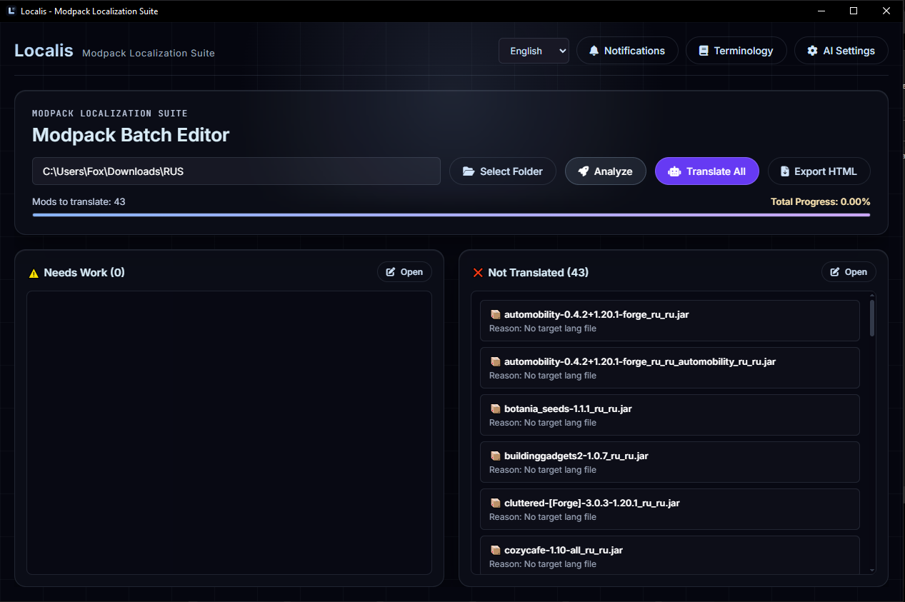
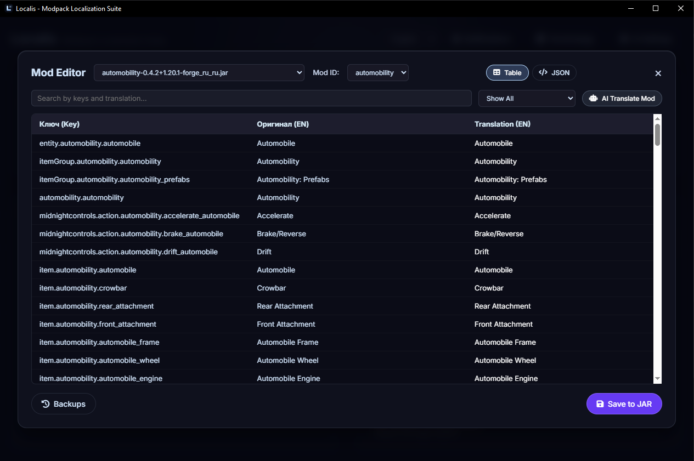
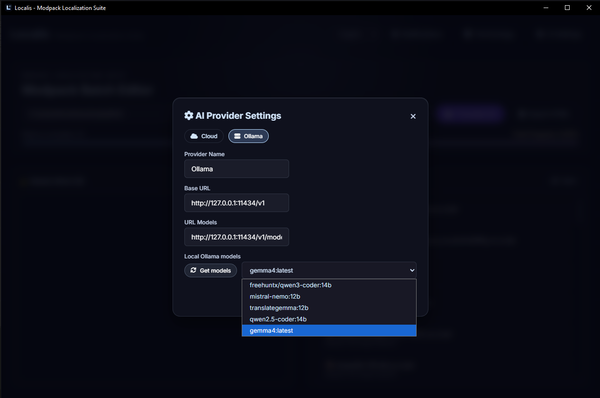
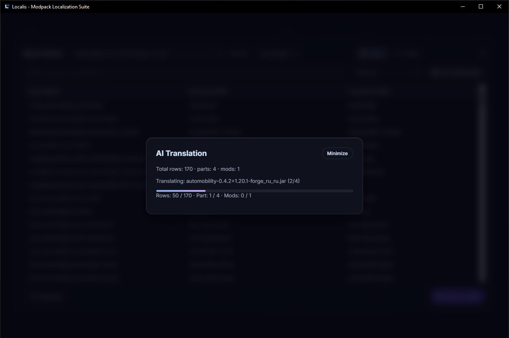
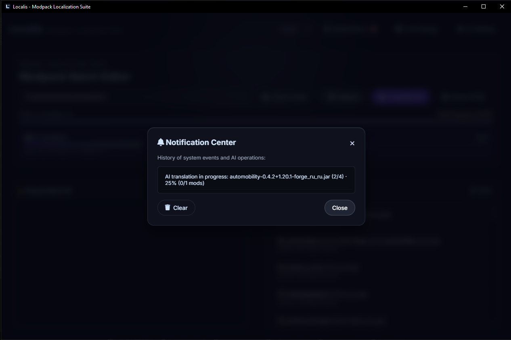

<p align="right"><a href="README.md">English</a> | <a href="README_RU.md">Русский</a> | <a href="README_CH.md">中文</a></p>

# Localis

**Localis** 是一款用于分析和翻译 Minecraft Mod 的桌面应用程序。它可以帮助您检查 Mod 语言文件、编辑翻译、使用 AI 服务提供商进行自动翻译，并在 HTML 报告中查看本地化覆盖率。

## 下载 Localis 1.0.0

| 平台 | 下载 |
| --- | --- |
| Windows | [](https://github.com/FoxSoul-dev/Localis/releases/download/v1.0.0/Windows-x64-Localis-Setup-1.0.0.exe)<br>[](https://github.com/FoxSoul-dev/Localis/releases/download/v1.0.0/win-unpacked.zip)<br>[](https://github.com/FoxSoul-dev/Localis/releases/download/v1.0.0/Windows-ARM-Localis-Setup-1.0.0.exe)<br>[](https://github.com/FoxSoul-dev/Localis/releases/download/v1.0.0/Windows-ARM-Localis-Portable-1.0.0.zip)  |
| macOS | [](https://github.com/FoxSoul-dev/Localis/releases/download/v1.0.0/MacOS-Silicon-Localis-1.0.0-arm64.dmg)<br>[](https://github.com/FoxSoul-dev/Localis/releases/download/v1.0.0/MacOS-intel-Localis-1.0.0.dmg) |
| Linux | [](https://github.com/FoxSoul-dev/Localis/releases/download/v1.0.0/Linux-x86_64-Localis-1.0.0.AppImage)<br>[](https://github.com/FoxSoul-dev/Localis/releases/download/v1.0.0/Linux-amd64-Localis-1.0.0.deb)<br>[](https://github.com/FoxSoul-dev/Localis/releases/download/v1.0.0/Linux-x86_64-Localis-1.0.0.rpm)<br>[](https://github.com/FoxSoul-dev/Localis/releases/download/v1.0.0/Linux-x64-Localis-1.0.0.pacman)<br>[](https://github.com/FoxSoul-dev/Localis/blob/main/packaging/aur/PKGBUILD) |

## 软件截图

<p align="center">
  
</p>

<p align="center">
  
</p>

<p align="center">
  
  
</p>

<p align="center">
  
</p>

## 功能特性

- 扫描 Minecraft Mod 的 `.jar` 文件并定位语言资源。
- 在应用内查看和编辑翻译，支持表格视图和 JSON 编辑器。
- 使用兼容 OpenAI 的 API 或本地 Ollama 模型翻译文本。
- 批量对所选 Mod 运行 AI 翻译，并实时显示字符串、批次和 Mod 的进度信息。
- 生成包含本地化状态和翻译问题的 HTML 报告。
- 将编辑后的语言文件保存回 JAR 压缩包，并支持备份与还原。
- 配置术语表规则并选择界面语言。

## 系统要求

- Node.js 和 npm（用于从源码运行）
- 兼容 OpenAI 的 API 接口，或已安装模型的 Ollama（用于 AI 翻译）

您也可以直接使用打包好的 Windows 安装包；运行已安装的版本无需安装 Node.js。

## 从源码运行

```bash
git clone https://github.com/FoxSoul-dev/Localis
cd Localis
npm install
npm start
```

构建 Windows 安装程序：

```bash
npm run dist:win
```

安装程序将生成在 `dist/` 目录中。

## 快速入门

1. 打开 Localis 并选择包含 Minecraft Mod 的文件夹。
2. 运行扫描以查找可用的本地化文件。
3. 选择一个 Mod 来查看或编辑其翻译。
4. 如需使用 AI 翻译，请在 **AI 设置** 中配置服务提供商并选择目标语言。
5. 检查翻译结果，然后将更改保存到 Mod 压缩包中。
6. 当需要分享本地化状态的概览时，可以导出 HTML 报告。

在将更改保存到 JAR 文件之前，Localis 会自动创建备份。如果需要，您可以使用应用内的备份控制功能恢复到先前的版本。

## AI 翻译设置

在 **AI 设置** 中，选择兼容 OpenAI 的提供商或 Ollama，并配置其接口端点和模型。如果所选提供商需要 API 密钥，请一并填入。使用 Ollama 时，请确保服务已在运行且对应的模型已下载完成。

翻译质量和处理速度取决于所选的模型、API 的可用性以及上下文限制。在发布 Mod 或 Modpack（整合包）之前，请务必人工复核 AI 生成的文本。

## 隐私说明

当您使用云端 AI 服务提供商时，选定用于翻译的文本将被发送至该提供商。使用 Ollama 时，请求将发送至配置好的 Ollama 服务器（可以是您本地的电脑）。请妥善保管 API 凭据，并阅读相关提供商的数据处理条款。

## 项目结构

- `main.js` — Electron 主进程及文件操作。
- `renderer.js` — 应用界面、本地化、报告生成和翻译工作流。
- `index.html` 与 `style.css` — 界面标记与样式。
- `assets/` — 应用图片与图标。
- `logger.js` — 应用日志记录。

## 开源协议

Localis 采用 [MIT 协议](LICENSE) 进行分发。完整条款请参阅 LICENSE 文件。
