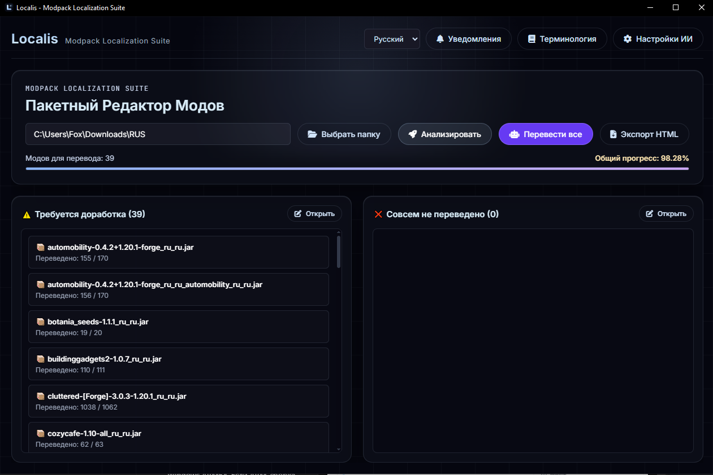
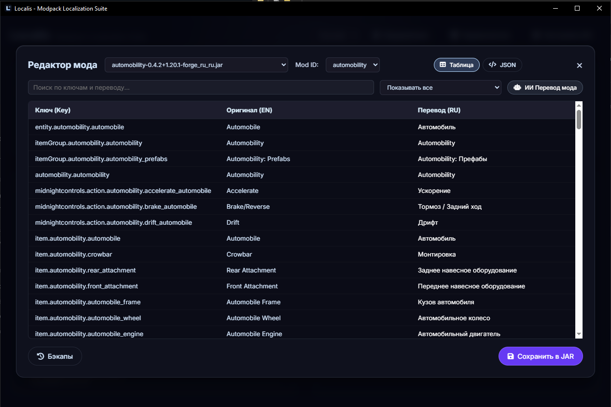
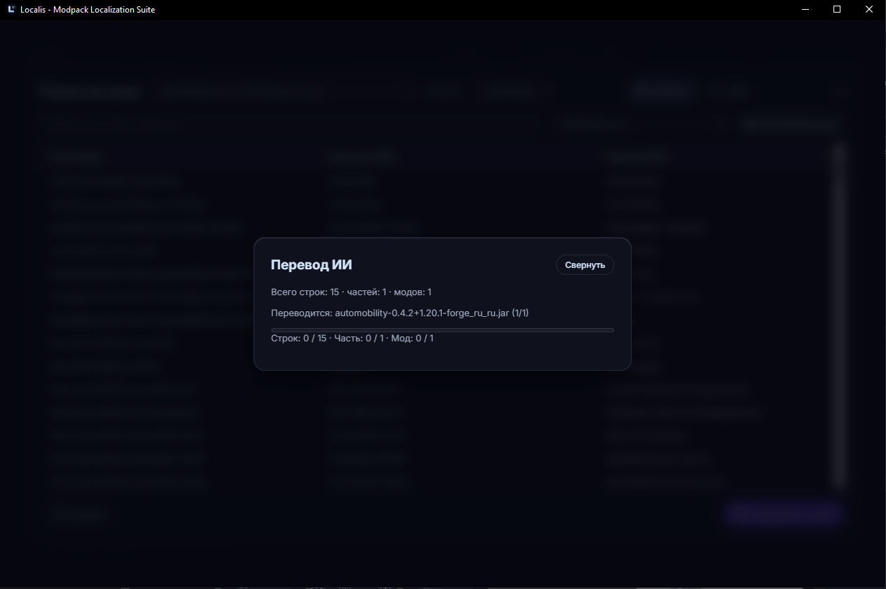
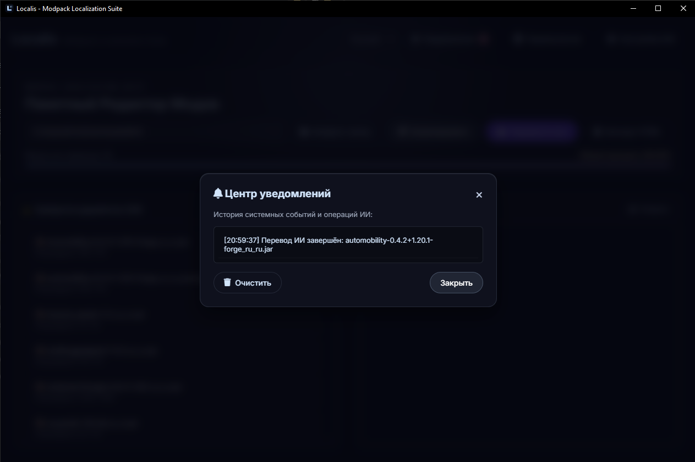

<p align="right"><a href="README.md">English</a> | <a href="README_RU.md">Русский</a> | <a href="README_CH.md">中文</a></p>

# Localis

**Localis** — настольная программа для анализа и перевода Minecraft-модов. Она помогает находить языковые файлы, редактировать переводы, переводить текст с помощью ИИ и проверять состояние локализации в HTML-отчёте.

## Скачать Localis 1.0.0

| Платформа | Загрузки |
| --- | --- |
| Windows | [](https://github.com/FoxSoul-dev/Localis/releases/download/v1.0.0/Windows-x64-Localis-Setup-1.0.0.exe)<br>[](https://github.com/FoxSoul-dev/Localis/releases/download/v1.0.0/win-unpacked.zip) |
| macOS | [](https://github.com/FoxSoul-dev/Localis/releases/download/v1.0.0/MacOS-Silicon-Localis-1.0.0-arm64.dmg)<br>[](https://github.com/FoxSoul-dev/Localis/releases/download/v1.0.0/MacOS-intel-Localis-1.0.0.dmg) |
| Linux | [](https://github.com/FoxSoul-dev/Localis/releases/download/v1.0.0/Linux-x86_64-Localis-1.0.0.AppImage)<br>[](https://github.com/FoxSoul-dev/Localis/releases/download/v1.0.0/Linux-amd64-Localis-1.0.0.deb)<br>[](https://github.com/FoxSoul-dev/Localis/releases/download/v1.0.0/Linux-x86_64-Localis-1.0.0.rpm)<br>[](https://github.com/FoxSoul-dev/Localis/releases/download/v1.0.0/Linux-x64-Localis-1.0.0.pacman)<br>[](packaging/aur/PKGBUILD) |

Установщик Windows ARM64 пока не входит в версию 1.0.0. Все файлы доступны на странице [релиза](https://github.com/FoxSoul-dev/Localis/releases/tag/v1.0.0).

## Скриншоты

<p align="center">
  
</p>

<p align="center">
  
</p>

<p align="center">
  
</p>

<p align="center">
  
</p>

## Возможности

- Сканирование `.jar`-файлов Minecraft-модов и поиск языковых ресурсов.
- Просмотр и редактирование переводов в интерфейсе, включая таблицу и JSON-редактор.
- Перевод с помощью OpenAI-совместимого API или локальной модели Ollama.
- Пакетный ИИ-перевод с отображением прогресса по строкам, частям и модам.
- Создание HTML-отчёта о состоянии локализации и проблемах перевода.
- Сохранение языковых файлов обратно в JAR с резервным копированием и восстановлением.
- Настройка терминологических правил и языка интерфейса.

## Требования

- Node.js и npm для запуска из исходного кода.
- Для ИИ-перевода: OpenAI-совместимый API или Ollama с установленной моделью.

В релизах доступен установщик Windows, установленная программа не требует Node.js.

## Запуск из исходного кода

```bash
git clone https://github.com/FoxSoul-dev/Localis
cd Localis
npm install
npm start
```

Чтобы собрать установщик Windows:

```bash
npm run dist:win
```

Сборка пакетов для остальных платформ выполняется на соответствующих агентах GitHub Actions:

```bash
npm run dist:mac    # DMG для Intel и Apple Silicon (требуется macOS)
npm run dist:linux  # AppImage, DEB, RPM и пакет pacman
```

Сборка Windows включает установщики x64 и ARM64. Результаты локальной сборки сохраняются в `dist/`. Отправка тега вида `v*` запускает кроссплатформенную сборку и публикует созданные пакеты в GitHub Release. Пакеты macOS не подписаны и не нотарифицированы, поэтому при первом запуске macOS может запросить подтверждение.

Рецепт AUR для Arch Linux (`localis-bin`) находится в [`packaging/aur/PKGBUILD`](packaging/aur/PKGBUILD). Он устанавливает AppImage из соответствующего GitHub Release.

## Начало работы

1. Запустите Localis и выберите папку с Minecraft-модами.
2. Выполните сканирование, чтобы найти доступные файлы локализации.
3. Выберите мод, чтобы просмотреть или отредактировать его переводы.
4. Для ИИ-перевода настройте провайдера в разделе **Настройки ИИ**.
5. Проверьте результат и сохраните изменения в архив мода.
6. При необходимости экспортируйте HTML-отчёт о состоянии локализации.

Перед сохранением изменений в JAR Localis создаёт резервную копию. Предыдущую версию можно восстановить через инструменты работы с резервными копиями в программе.

## Настройка ИИ-перевода

В разделе **Настройки ИИ** выберите OpenAI-совместимый провайдер или Ollama и укажите адрес и модель. Если провайдер требует API-ключ, добавьте его в настройках. Для Ollama запустите сервер и заранее загрузите нужную модель.

Качество и скорость перевода зависят от модели, доступности API и ограничений контекста. Перед распространением мода или модпака проверьте текст, созданный ИИ.

## Конфиденциальность

При использовании облачного ИИ текст, выбранный для перевода, отправляется провайдеру. В случае Ollama запросы направляются на настроенный сервер Ollama, который может работать на вашем компьютере. Храните API-ключи в безопасности и ознакомьтесь с правилами обработки данных провайдера.

## Структура проекта

- `main.js` — главный процесс Electron и операции с файлами.
- `renderer.js` — интерфейс, локализация, отчёты и процесс перевода.
- `index.html` и `style.css` — разметка и оформление интерфейса.
- `assets/` — изображения и значки программы.
- `logger.js` — журналирование приложения.

## Лицензия

Localis распространяется на условиях [лицензии MIT](LICENSE). Полный текст условий приведён в файле лицензии.
